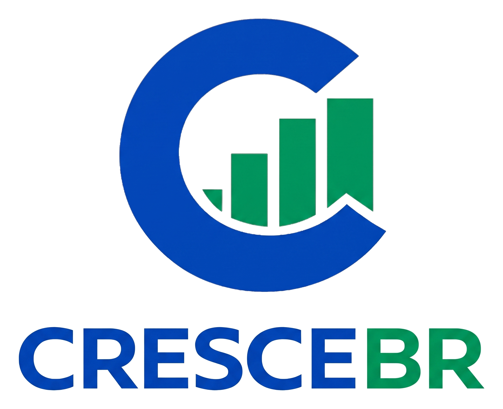
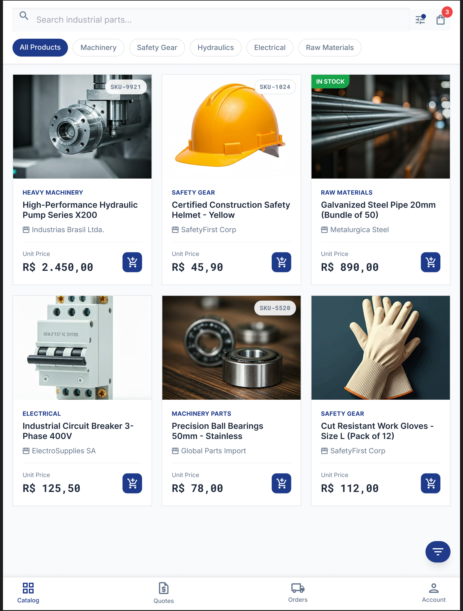

<div align="center">
  
  <br />
  <a href="#key-features">English</a>&nbsp;&nbsp;|&nbsp;&nbsp;<a href="#visao-geral">Português</a>
</div>

<h1 align="center">CresceBR — B2B Marketplace</h1>
<p align="center">
  A personal B2B marketplace project for Brazilian companies.
</p>
<p align="center">
  <a href="https://crescebr.com.br/">Public demo</a> · <a href="https://github.com/oguarni/crescebr-b2b-marketplace/actions/workflows/ci.yml">CI runs</a>
</p>

The public site is a static demo: an axios adapter answers API calls inside the browser. The Express backend and PostgreSQL database run separately in local development and CI.

<p align="center">
  
  
  
  
  
  <a href="LICENSE"></a>
</p>

---

<div align="center">
  
</div>

---

## Why CresceBR

CresceBR models purchasing between buyer and supplier companies. Buyers browse industrial products and request volume quotations; suppliers manage their products and respond to quotations. Administrators review companies and monitor orders.

## Explore the Demo

Open [crescebr.com.br](https://crescebr.com.br/). Browse anonymously or choose a role on the [demo sign-in page](https://crescebr.com.br/login). The language menu offers Portuguese and English. Sign out through the account menu before choosing another role.

| Role          | Suggested path                                                                                                                                                                                                                                    |
| ------------- | ------------------------------------------------------------------------------------------------------------------------------------------------------------------------------------------------------------------------------------------------- |
| Anonymous     | Search the catalog, apply availability or price filters, and open a product for its specifications and minimum order quantity.                                                                                                                    |
| Buyer         | Add a product to a quotation and submit it. In **My Quotations**, convert a **processed** quotation to an order, then inspect **My Orders**. A fresh demo includes a processed quotation; a new request first needs supplier or admin processing. |
| Supplier      | Open the dashboard, manage products and respond to quotations containing the supplier's products. In orders, shipping requires a tracking number and a 44-digit NF-e access key with a valid check digit. Use fictional test data.                |
| Administrator | Review the company verification queue, process quotations and inspect transaction analytics. A fresh demo includes pending and rejected companies.                                                                                                |

### Hosted Demo Limits

- The accounts and transactions are fictional. Public sign-up is closed and no payment is charged.
- The hosted demo has no Express server or database. Browser-issued demo tokens and role checks illustrate the interface; they do not demonstrate server-side authentication, password hashing, JWT verification or API rate limiting.
- Company verification is simulated. The demo's CNPJ action updates a local flag without calling Brasil API.
- Demo records persist in this browser's localStorage and are not shared between visitors or devices. `resetCresceBRDemo()` in the browser console restores seeded demo records; it does not clear the cart or sign-in state. Clearing this site's browser data also clears its saved session and selections.
- Pricing uses volume tiers, a flat 18% tax and estimated shipping based on assumed weight per unit and a default distance. These are illustrative calculations. The [demo implementation](frontend/src/demo/pricing.ts) is a separate port of the [backend pricing service](backend/src/services/quoteService.ts), with a remaining [drift risk (#18)](https://github.com/oguarni/crescebr-b2b-marketplace/issues/18).
- Quotation detail pages show a current estimate from today's catalog prices, volume tiers and estimates, in the demo and the full stack alike. Quotations keep no historical price snapshot, so an order's recorded total can differ from its quotation's current estimate. Seeded order totals are illustrative.
- CSV import is a backend API capability. The supplier UI exposes import/export placeholders; they do not import or export a catalog, and the hosted demo has no CSV import handler.

The backend implementation, migrations and automated tests are available in this repository. The End-to-End CI job exercises the real stack with PostgreSQL 15 and Redis 7.

## Key Features

- **Company review** — The backend checks CNPJ digits and queries Brasil API. Some provider failures fall back to digit validation only; timeouts and throttling report unavailability. Admin approval is a separate step.
- **Access control** — Backend middleware enforces roles and supplier approval; services check resource ownership.
- **Quotation pricing** — Volume discounts with illustrative tax and shipping estimates.
- **Order management** — Quotation conversion, status transitions and order history.
- **CSV import API** — Product import, sample template and import statistics on backend endpoints.
- **Admin tools** — Company verification, quotation management and transaction analytics.
- **Backend security controls** — JWT sessions, bcrypt password hashing, Helmet headers, input validation and rate limits.

---

## Tech Stack

| Layer         | Technology                        |
| ------------- | --------------------------------- |
| Frontend      | React 19, TypeScript, MUI, Vite   |
| Backend       | Node.js, Express 5, TypeScript    |
| Database      | PostgreSQL 15, Sequelize ORM      |
| Auth          | JWT, bcrypt, Helmet               |
| File handling | Multer (CSV import, file uploads) |
| External API  | Brasil API (CNPJ validation)      |
| DevOps        | Docker, Docker Compose            |

---

## Getting Started

### Docker (recommended)

```bash
git clone https://github.com/oguarni/crescebr-b2b-marketplace.git
cd crescebr-b2b-marketplace

cp .env.example .env
# In .env, replace JWT_SECRET with the output of `openssl rand -base64 64`
# and DB_PASSWORD with a password of your own.

docker compose up --build
```

This starts PostgreSQL, Redis and the API at `http://localhost:3001/api/v1`. Compose takes its settings from the root `.env`, and the API rejects the `JWT_SECRET` placeholder from `.env.example`, so logging in fails until you replace it.

The `frontend` service builds an nginx image that doesn't reach this local API. For the UI, run `npm run setup` and `npm run dev -w frontend`, then open `http://localhost:5173`. Vite forwards `/api` to port 3001.

### Local development

**Prerequisites:** Node.js 20+, PostgreSQL 15 running locally.

```bash
npm run setup   # install all workspace dependencies
npm run dev     # start frontend (port 5173) + backend (port 3001)
```

---

## Project Structure

```text
crescebr-b2b-marketplace/
├── frontend/          # React 19 + TypeScript + Vite + MUI
├── backend/           # Node.js + Express 5 + TypeScript + Sequelize
├── shared/            # Shared TypeScript types
├── docs/              # Design specs and operational docs
├── docker-compose.yml
└── package.json       # npm workspace root
```

---

## Architecture

```text
Routes + middleware → Controllers → Services → Sequelize models → PostgreSQL
```

Services normally access Sequelize models directly. The quotation service also uses focused query helpers in `backend/src/repositories/`; there is no mandatory repository layer. Shared TypeScript types live in `shared/`.

**Hosted path:** React → axios demo adapter → seeded records and browser localStorage. [Demo data generation](frontend/scripts/generate-demo-data.cjs) derives the catalog and companies from backend seeders.

**Local full-stack path:**

```text
┌──────────────────┐    ┌───────────────────┐    ┌──────────────────┐
│  React Frontend  │    │  Express Backend  │    │   PostgreSQL     │
│   (Port 5173)    │◄──►│   (Port 3001)     │◄──►│   (Port 5432)    │
└──────────────────┘    └───────────────────┘    └──────────────────┘
                                │
                                ▼
                        ┌──────────────────┐
                        │   Brasil API     │
                        │ CNPJ Validation  │
                        └──────────────────┘
```

---

## API Overview

All endpoints are served under `/api/v1`.

| Domain                            | Route definitions                                 |
| --------------------------------- | ------------------------------------------------- |
| Authentication and sessions       | [auth.ts](backend/src/routes/auth.ts)             |
| Products and CSV import           | [products.ts](backend/src/routes/products.ts)     |
| Quotations and pricing            | [quotations.ts](backend/src/routes/quotations.ts) |
| Orders and history                | [orders.ts](backend/src/routes/orders.ts)         |
| Administration and company review | [admin.ts](backend/src/routes/admin.ts)           |
| Supplier ratings                  | [ratings.ts](backend/src/routes/ratings.ts)       |

## Engineering Decisions and Evidence

| Problem                                                              | Implementation and verification                                                                                                                                                                                                                                                       |
| -------------------------------------------------------------------- | ------------------------------------------------------------------------------------------------------------------------------------------------------------------------------------------------------------------------------------------------------------------------------------- |
| Repeated order conversion must not create duplicate orders.          | [Order service](backend/src/services/orderService.ts) rechecks quotation state under a transaction and row lock. The [PostgreSQL concurrency spec](e2e/specs/order-conversion.spec.ts) sends six conversions, expects one success and verifies one persisted order.                   |
| The hosted demo needs the response shape expected by the real UI.    | The [axios adapter](frontend/src/demo/adapter.ts) serializes dates and returns HTTP-style errors. [Adapter tests](frontend/src/demo/__tests__/adapter.test.ts) cover both; [handler tests](frontend/src/demo/__tests__/handlers.test.ts) cover role scoping and persisted demo state. |
| A page guard alone cannot enforce API permissions.                   | [RBAC middleware](backend/src/middleware/rbac.ts) and its [tests](backend/src/middleware/__tests__/rbac.test.ts) cover backend permissions. [Role-gating E2E tests](e2e/specs/role-gating.spec.ts) exercise frontend access with real API sessions.                                   |
| Pricing uses estimates; CNPJ lookup depends on an external provider. | [Pricing tests](backend/src/services/__tests__/quoteService.test.ts) cover tiers and calculations. [CNPJ service tests](backend/src/services/__tests__/cnpjService.test.ts) cover validation and provider failures. Shipping and tax remain estimates.                                |
| Closing the registration UI must also close the API.                 | The [registration gate](backend/src/middleware/registrationGate.ts) defaults production sign-up to closed unless explicitly enabled. [Real-router tests](backend/src/__tests__/integration/registrationGate.test.ts) verify the refusal before database work.                         |

### Automated Checks

[CI runs](https://github.com/oguarni/crescebr-b2b-marketplace/actions/workflows/ci.yml) and the [workflow definition](.github/workflows/ci.yml) expose the checks:

- **Backend:** ESLint, TypeScript build and Jest/Supertest tests, primarily with in-memory SQLite.
- **Frontend:** shared-type build, ESLint, TypeScript checks for the app and Vite config, Vite build, Vitest/Testing Library tests and checks for lint-staged file routing.
- **End-to-End:** Playwright exercises the real API with PostgreSQL 15 and Redis 7 on desktop and mobile projects. Examples include [sign-in](e2e/specs/auth.spec.ts), [catalog filters](e2e/specs/buyer-catalogue-filters.spec.ts) and [shipping validation](e2e/specs/supplier-orders.spec.ts).

CI uploads coverage and Playwright reports as run artifacts, subject to retention. A push to `main` publishes the frontend only after the check jobs pass and the commit is still the branch tip. The Live Grade job then checks deployed HTTP security headers; it does not verify application authorization or business correctness.

---

## Development

```bash
npm run dev      # Start frontend + backend concurrently
npm run build    # Production build (shared → backend → frontend)
npm run test     # Run tests across all workspaces
npm run lint     # Lint all workspaces
npm run typecheck # Check all workspaces and the Vite config
npm run clean    # Remove node_modules and dist
```

**Backend only:**

```bash
cd backend
npm run dev      # Hot reload dev server
npm run test     # Jest test suite
npm run lint     # ESLint
```

**Frontend only:**

```bash
cd frontend
npm run dev      # Vite dev server
npm run build    # Production build
npm run test     # Vitest suite
```

---

## Demo Credentials

These accounts are seeded into the local development database by `backend/seeders/`, and the same
three are published on the hosted demo as one-click sign-in cards — the demo answers its own API in
the browser, so there is no server to authenticate against. They are fixtures, not secrets.
**Do not use these credentials in any real environment.**

| Role     | Email                  | Password      | CNPJ                 |
| -------- | ---------------------- | ------------- | -------------------- |
| Admin    | `admin@crescebr.com`   | `admin123`    | `00.000.000/0001-00` |
| Supplier | `supplier@example.com` | `supplier123` | `22.222.222/0001-22` |
| Buyer    | `buyer@example.com`    | `buyer123`    | `33.333.333/0001-33` |

---

## Documentation

Design specs, operational history, and tooling references live in [`docs/`](docs/):

| Document                                               | Purpose                                                              |
| ------------------------------------------------------ | -------------------------------------------------------------------- |
| [Security Operations](docs/SECURITY.md)                | JWT incident record, remediation status, and deployment requirements |
| [Maturity Improvements](docs/MATURITY_IMPROVEMENTS.md) | Security fixes, testing, and business logic enhancements             |
| [Frontend Design Spec](docs/design-prompt.md)          | Visual language and page layouts                                     |

---

## Contributing

1. Fork the repository
2. Create a feature branch from `main` (`git checkout -b feature/your-feature`)
3. Write tests for any new functionality
4. Ensure all checks pass: `npm run build && npm run lint && npm run test`
5. Commit with a clear, descriptive message in English
6. Open a Pull Request against `main`

Follow the existing conventions: TypeScript strict mode, ESLint + Prettier formatting, and the layered architecture described above. Domain-specific guidance is available in `backend/CLAUDE.md` and `frontend/CLAUDE.md`.

---

## License

Copyright (C) 2025-2026 Gabriel Felipe Guarnieri. All rights reserved.

This project is dual-licensed under the **AGPL-3.0 + Commercial License** model:

- **Open-source use**: Licensed under the [GNU Affero General Public License v3.0 (AGPL-3.0)](LICENSE).
- **Commercial use**: A proprietary commercial license is available for use cases incompatible with the AGPL-3.0. See [LICENSING.md](LICENSING.md) for details.

> **Retroactive clause**: This license applies retroactively to all past commits and versions of this repository, superseding any previously stated license.

For commercial licensing inquiries, contact the author via [LinkedIn](https://www.linkedin.com/in/oguarni/).

---

<h2 id="visao-geral">Português</h2>

**CresceBR** é um projeto pessoal de marketplace B2B para empresas brasileiras. Compradores consultam produtos industriais e solicitam cotações por volume. Fornecedores gerenciam seus produtos e respondem a cotações; administradores analisam empresas e acompanham pedidos.

### Explorar a demonstração

Acesse [crescebr.com.br](https://crescebr.com.br/) e escolha uma conta na [página de demonstração](https://crescebr.com.br/login). O menu de idioma oferece português e inglês. Para trocar de papel, saia pelo menu da conta e escolha outra empresa.

- **Visitante:** pesquise no catálogo, aplique filtros e abra um produto para consultar especificações e pedido mínimo.
- **Comprador:** adicione um produto à cotação e envie a solicitação. Em **Minhas Cotações**, converta uma cotação **processada** em pedido e consulte **Meus Pedidos**. A demonstração inicial inclui uma cotação processada; novas solicitações precisam primeiro ser processadas pelo fornecedor ou administrador.
- **Fornecedor:** consulte o painel, gerencie produtos e responda a cotações que contenham seus produtos. Para marcar um pedido como enviado, informe um rastreio e uma chave de acesso NF-e de 44 dígitos com dígito verificador válido, usando dados fictícios de teste.
- **Administrador:** analise a fila de empresas, processe cotações e consulte as transações. Os dados iniciais incluem empresas pendentes e rejeitadas.

### Limites da demonstração

As contas e transações são fictícias. O cadastro público está fechado e não há cobrança. O site publicado responde às chamadas de API no próprio navegador, sem servidor Express ou banco de dados. Os tokens e controles de papel locais demonstram a interface; autenticação no servidor, hash de senhas, verificação JWT e limites de requisições pertencem ao backend.

A validação de CNPJ no site apenas altera um indicador local, sem consultar a Brasil API. No backend, o serviço verifica os dígitos e consulta o provedor: algumas falhas usam apenas a validação dos dígitos; timeout e limite de requisições indicam indisponibilidade. A aprovação administrativa é uma etapa separada.

Os registros ficam no localStorage deste navegador e não são compartilhados entre visitantes ou dispositivos. `resetCresceBRDemo()` no console restaura os registros iniciais, mas mantém o carrinho e a sessão. Limpar os dados deste site no navegador também remove a sessão e as seleções salvas.

A precificação aplica descontos por volume, imposto fixo de 18% e frete estimado com peso presumido por unidade e distância padrão. São cálculos ilustrativos. O código da demonstração é uma adaptação separada do serviço de backend; o [risco de divergência permanece registrado na issue #18](https://github.com/oguarni/crescebr-b2b-marketplace/issues/18). A página de detalhe da cotação mostra uma estimativa com os preços, faixas de volume e estimativas atuais do catálogo, tanto na demonstração quanto no ambiente completo. As cotações não guardam um registro histórico de preços, então o total registrado de um pedido pode diferir da estimativa atual da cotação. Os totais dos pedidos iniciais são ilustrativos. A importação CSV existe na API. Os controles de importar e exportar da interface são placeholders: não importam nem exportam o catálogo, e a demonstração não tem handler para importação CSV.

### Arquitetura e evidências

No site publicado, o caminho é React → adapter axios → dados iniciais e localStorage. No ambiente completo, rotas e middleware encaminham para controllers, serviços e models Sequelize com PostgreSQL. Os serviços normalmente acessam os models diretamente; o serviço de cotações também usa helpers de consulta, sem uma camada obrigatória de repositórios. Os tipos compartilhados ficam em `shared/`.

A seção [Engineering Decisions and Evidence](#engineering-decisions-and-evidence) liga cada decisão ao código e aos testes: conversão concorrente de cotações, formato das respostas da demonstração, permissões, precificação, falhas do provedor de CNPJ e bloqueio do cadastro na API.

O [CI](https://github.com/oguarni/crescebr-b2b-marketplace/actions/workflows/ci.yml) executa lint, build, checagem de tipos e testes Jest e Vitest; a maioria dos testes de backend usa SQLite em memória. O job End-to-End executa Playwright com a API real, PostgreSQL 15 e Redis 7, em projetos desktop e mobile. Relatórios de cobertura e Playwright ficam nos artefatos de cada execução, conforme o prazo de retenção. Um push em `main` publica o frontend após os checks e a confirmação de que o commit ainda é a ponta da branch. Depois, o Live Grade verifica os headers HTTP publicados; essa verificação não comprova permissões nem regras de negócio.

### Como começar

```bash
git clone https://github.com/oguarni/crescebr-b2b-marketplace.git
cd crescebr-b2b-marketplace
cp .env.example .env
# No .env, troque JWT_SECRET pela saída de `openssl rand -base64 64`
# e DB_PASSWORD por uma senha sua.
docker compose up --build
```

Isso sobe o PostgreSQL, o Redis e a API em `http://localhost:3001/api/v1`. O Compose lê as configurações do `.env` da raiz, e a API recusa o `JWT_SECRET` de exemplo do `.env.example`, então o login falha até você trocá-lo.

O serviço `frontend` gera uma imagem nginx que não alcança a API local. Para a interface, rode `npm run setup` e `npm run dev -w frontend` e abra `http://localhost:5173`. O Vite encaminha `/api` para a porta 3001.

Para instruções detalhadas de desenvolvimento, consulte as seções em inglês acima.
